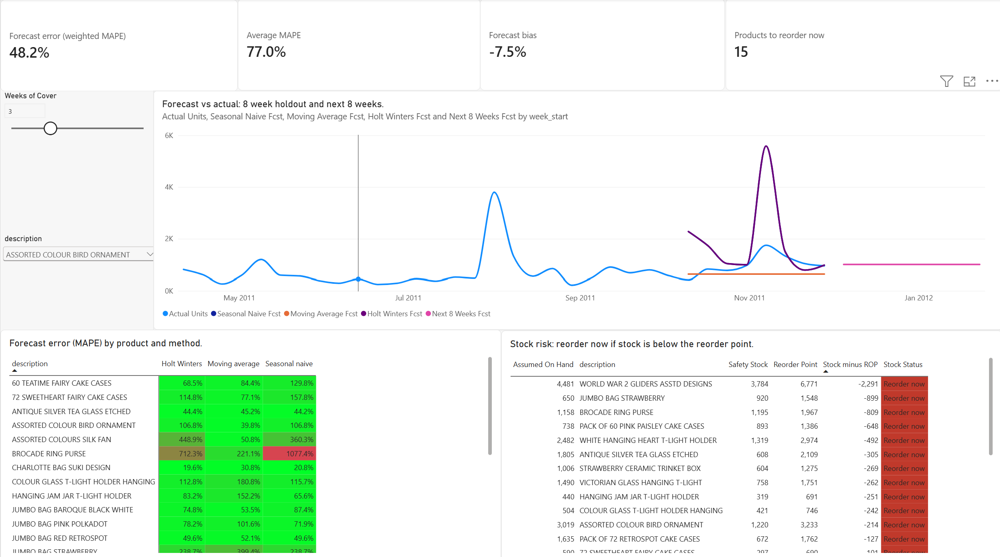

# Demand Forecasting and Inventory Planning

Weekly demand forecasting for a real UK online retailer's top 25 products, measured the way demand planners measure it (MAPE, weighted MAPE, bias on a holdout period), turned into safety stock, reorder points and a list of products that need ordering now.

**Tools:** Python (pandas, statsmodels), SQL (SQLite), Power BI (DAX, what if parameter)



## Business question

For the top selling products, which forecasting method should a planner trust, how accurate is it, and which products need a replenishment order now to keep a 95% service level?

## Data source

UCI Machine Learning Repository, **Online Retail II**: every sale of a UK based online giftware wholesaler, 1 Dec 2009 to 9 Dec 2011 (1,067,371 lines).
https://archive.ics.uci.edu/dataset/502/online+retail+ii

The data is not stored in this repo; `src/01_load_clean.py` downloads it.

**Cleaning** (in `src/01_load_clean.py`):

* The two Excel sheets overlap on 1 to 9 Dec 2010; 22,523 duplicated rows are removed.
* Postage, fees, manual adjustments and gift vouchers (5,992 lines) and zero price lines (5,938) are removed.
* Demand is **net**: cancellations stay in as negative quantities, so an order placed and cancelled the same day (for example a 74,215 unit order on 18 Jan 2011) cancels itself out.
* Weekly demand (Monday to Sunday) for the 104 complete weeks, 7 Dec 2009 to 4 Dec 2011, built in SQL (`sql/weekly_demand.sql`).
* Products: the top 25 by volume among products that sold in at least 95 of the 104 weeks, so each one has a full history.

## Method

| Step | What it does |
|---|---|
| Holdout | The last 8 weeks (10 Oct to 4 Dec 2011) are hidden, each method forecasts them from the 96 weeks before, and the forecasts are compared with what really sold |
| Seasonal naive | Same week last year |
| Moving average | Average of the last 8 weeks |
| Holt Winters | Level, damped trend and 52 week seasonality (statsmodels); starting values set from the first year because there are under two full years of training data |
| Best method | Lowest MAPE per product on the holdout; then refitted on all 104 weeks to forecast the next 8 weeks |

## KPI definitions

| KPI | Definition |
|---|---|
| MAPE | average of abs(actual minus forecast) / actual across the 8 holdout weeks: the typical % miss per week |
| Weighted MAPE | sum of abs(actual minus forecast) / sum of actual: big weeks count more, so it is not blown up by quiet weeks |
| Bias | (total forecast minus total actual) / total actual: positive means over forecasting |
| Safety stock | z x forecast error (RMSE on the holdout) x square root of lead time |
| Reorder point | forecast demand over the lead time + safety stock |
| Reorder now | assumed stock on hand is below the reorder point |

## Assumptions

* **Service level 95%** (z = 1.645): stock should cover demand in 95% of lead times.
* **Lead time 2 weeks** from placing an order to receiving it.
* **Stock on hand:** the dataset has sales only, no stock levels. Each product is assumed to hold **3 weeks of cover** (3 x its average weekly demand over the last 8 weeks). In the dashboard this is a slider from 1 to 8 weeks. In a real business this column comes from the warehouse system.
* The best method is chosen and scored on the same 8 week holdout, so its accuracy is slightly flattering; a longer test would use rolling holdouts.

## Findings

1. **The simplest method won.** The 8 week moving average was the most accurate method for 14 of 25 products (weighted MAPE 58.2%), ahead of Holt Winters (6 products, 77.9%) and seasonal naive (5 products, 87.8%). Weekly wholesale demand is lumpy, and last year's pattern was a poor guide: seasonal naive over forecast by 44.4%.
   *Source: `outputs/accuracy_overall.csv`*
2. **Using the best method per product gives a weighted MAPE of 48.2% and a bias of minus 7.5%** (a slight under forecast). Accuracy varies widely: Charlotte Bag Suki Design (19.6% MAPE) and Lunch Bag Red Retrospot (20.2%) forecast well, while Jumbo Bag Strawberry (238.7%), Pack of 60 Pink Paisley Cake Cases (223.9%) and Brocade Ring Purse (221.1%) are too erratic for weekly forecasting and need a different approach (monthly buckets or a minimum stock rule).
   *Source: `outputs/accuracy_overall.csv`, `outputs/accuracy_by_product.csv`*
3. **With 3 weeks of cover, 15 of the 25 products need ordering now.** The biggest gap is World War 2 Gliders: about 4,480 units on hand against a reorder point of 6,771 (2,291 short), driven by a safety stock of 3,784 because its forecast error is high. Holding 4 weeks of cover cuts the list to 6 products, and 5 weeks to 3.
   *Source: `outputs/inventory_plan.csv` (the 4 and 5 week counts come from the dashboard slider)*

## Dashboard

One page in Power BI (`powerbi/Demand_Planning.pbix`):

* Cards for weighted MAPE, average MAPE, bias and products to reorder now (all 25 products)
* Forecast vs actual for the chosen product: history, the 3 holdout forecasts, and the next 8 weeks
* MAPE by product and method, coloured from green (accurate) to red
* Stock risk list: assumed stock, safety stock, reorder point, and a Reorder now / OK flag
* **Weeks of Cover slider** (what if parameter): moves the stock assumption and every risk figure updates live

DAX measures: [`powerbi/measures.dax`](powerbi/measures.dax).

## How to run

```bash
pip install -r requirements.txt
python src/01_load_clean.py
python src/02_weekly_demand.py
python src/03_forecast_inventory.py
```

Then open the Power BI file and click **Home > Refresh**.

## Project structure

```
src/01_load_clean.py          download, clean, save sales lines to SQLite
sql/weekly_demand.sql         weekly net demand for the top 25 products (zero filled)
src/02_weekly_demand.py       runs the SQL, saves outputs/weekly_demand.csv
src/03_forecast_inventory.py  3 forecasts, accuracy, best method, safety stock, reorder point
outputs/                      every result file; the source of every number in this README
powerbi/                      Power BI report and DAX measures
docs/                         dashboard screenshot
```
